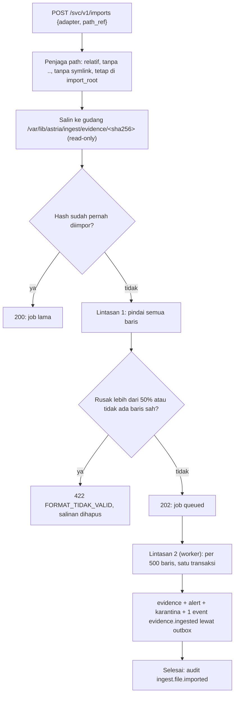

<!-- astria-logo -->
<p align="center">
  <picture>
    <source media="(prefers-color-scheme: dark)" srcset=".github/assets/astria-logo-reverse.svg">
    
  </picture>
</p>

# Astria ingest

Menerima dan menormalkan alert (Hayabusa JSON bertag ATT&CK) dan menyimpan bukti dengan hash.

> Status: Tahap 1 (ingest#2). Impor berkas Hayabusa JSONL lewat API, gudang bukti dengan hash, normalisasi, karantina baris rusak, event `evidence.ingested` per batch, dan API baca bukti untuk triage dan verifier. Repo ini adalah submodule dari workspace `triase-dfir` (folder `ingest/`). Rancangan: `notes/2026-11-06-triase-dfir-app-ingest.md` di repo root. Lajur developer: 1.

## Tech stack

Python 3.14, FastAPI, SQLAlchemy 2.1, PostgreSQL 18, NATS JetStream, uv

## Perintah

```text
uv sync                                   # butuh akses ke repo privat contracts dan common (tag git)
uv run ruff format --check . && uv run ruff check .
uv run pytest                             # uji DB dilewati tanpa ASTRIA_TEST_DATABASE_URL
sh ../common/template/localtest.sh        # di kontainer py devenv: uji terhadap salinan kerja common dan contracts
```

Menjalankan bersama layanan lain: `pwsh ../devenv/scripts/dev.ps1 up`, lalu `dev.ps1 smoke`.

## Cara kerja



- **Bukti asli utuh**: berkas disalin ke gudang content-addressed; tiap baris juga disimpan apa adanya (`evidence.raw`) dengan `record_sha256`. `batch_sha256` = SHA-256 dari hash baris yang diurutkan dan digabung LF.
- **ID stabil**: sumber `hb01`, `hb02`, ... (sequence PostgreSQL); bukti `EV-hb01-000001`; alert `AL-hb01-000001`. Nomor baris fisik 1-based, baris kosong ikut dihitung.
- **Sanitasi saat output**: teks yang keluar dari API dibersihkan dari karakter kontrol, disensor (kata sandi di `net user`, `-p`, `/p:`, `password=`), lalu dipotong. Kolom `raw` tidak pernah dikirim.
- **Tahan restart**: job lanjut dari batch terakhir yang ter-commit (`last_record_no`). Satu advisory lock PostgreSQL per job, jadi aman dengan lebih dari satu replika. Galat sementara (koneksi DB, I/O) dicoba ulang dengan jeda 1 sampai 60 detik; galat data membuat job `failed`.

## API (`/svc/v1`)

Semua endpoint wajib token layanan untuk audiens `svc:ingest`, lalu nama pemanggil dicocokkan dengan daftar di setting.

| Endpoint | Pemanggil (setting) | Jawaban |
|---|---|---|
| `POST /imports` `{"adapter":"hayabusa","path_ref":"chains/a.jsonl"}` | `import_callers`: `svc:api`, `svc:seed`, `svc:devtools` | `202` job baru, `200` berkas yang sama sudah diimpor, `413` terlalu besar, `422` path atau isi ditolak |
| `GET /imports/{job_id}` | `import_callers` | Status (`queued`, `running`, `completed`, `completed_with_errors`, `failed`), progres, statistik, contoh galat tanpa isi baris |
| `POST /evidence:batch` `{"ids":[...]}` (maks 500) | `read_callers`: `svc:triage`, `svc:verifier`, `svc:api`, `svc:dfir` | `{items, not_found}`; item berisi hash, host, account, kind, fields, excerpt tersanitasi |
| `GET /jobs/{job_id}/alerts?from=&to=&cursor=&limit=` (maks 500) | `read_callers` | Alert berurutan `record_no` dengan `next_cursor`; `from`/`to` mengikuti `batch_ref` di event |

`svc:devtools` di daftar impor hanya sementara, sampai principal `svc:seed` tersedia di identity.

### Kode galat

| Kode | HTTP | Arti |
|---|---|---|
| `TOKEN_WAJIB`, `AUDIENS_SALAH`, `PEMANGGIL_DITOLAK` | 401, 403, 403 | Token tidak ada, audiens salah, layanan tidak ada di daftar pemanggil |
| `VALIDASI_GAGAL`, `ID_TIDAK_VALID` | 400 | Body tidak sesuai skema, format ID bukti salah |
| `PATH_TIDAK_VALID`, `PATH_TIDAK_ADA`, `PATH_SYMLINK`, `PATH_BUKAN_BERKAS`, `PATH_DI_LUAR_ROOT` | 422 | `path_ref` ditolak penjaga path |
| `BERKAS_TERLALU_BESAR` | 413 | Lebih dari `max_file_bytes` |
| `BERKAS_TIDAK_TERBACA`, `BERKAS_BERUBAH` | 422 | Tidak bisa dibuka, atau berkas berganti antara pemeriksaan dan pembukaan |
| `ENCODING_TIDAK_DIDUKUNG`, `TERLALU_BANYAK_BARIS`, `FORMAT_TIDAK_VALID` | 422 | UTF-16/32, lebih dari `max_lines`, terlalu banyak baris rusak |
| `JOB_TIDAK_ADA` | 404 | Job tidak ditemukan |
| `INGEST_TIDAK_SIAP` | 503 | Basis data belum siap |

Galat per baris (dikarantina di `rejected_record`, impor tetap jalan): `BARIS_TERLALU_PANJANG`, `UTF8_RUSAK`, `JSON_RUSAK`, `KEY_GANDA`, `NILAI_TIDAK_SAH`, `TERLALU_DALAM`, `TEKS_TIDAK_SAH`, `BUKAN_OBJEK`, `FIELD_WAJIB`, `TIMESTAMP_TIDAK_SAH`.

## Konfigurasi (env `ASTRIA_*`)

| Env | Bawaan | Isi |
|---|---|---|
| `ASTRIA_IMPORT_ROOT` | `/data/import` | Folder impor, di-mount read-only |
| `ASTRIA_EVIDENCE_STORE` | `/var/lib/astria/ingest/evidence` | Gudang bukti; pasang volume di `/var/lib/astria/ingest` (folder milik uid 10001 di image) |
| `ASTRIA_MAX_FILE_BYTES`, `ASTRIA_MAX_LINE_BYTES` | 1 GiB, 1 MiB | Batas ukuran berkas dan baris |
| `ASTRIA_MAX_LINES`, `ASTRIA_MAX_DEPTH` | 999999, 32 | Batas jumlah baris (kapasitas ID 6 digit) dan kedalaman JSON |
| `ASTRIA_BATCH_SIZE`, `ASTRIA_REJECT_RATIO` | 500, 0.5 | Baris per batch dan event, ambang penolakan berkas |
| `ASTRIA_IMPORT_CALLERS`, `ASTRIA_READ_CALLERS` | lihat tabel API | Daftar pemanggil (JSON list) |

### Batasan yang diketahui

- Lintasan 1 membaca seluruh berkas di dalam request `POST /imports`, supaya berkas rusak langsung dijawab `422`. Untuk berkas ratusan MB request bisa lama; roadmap: pindai di worker dan jawab `202` lebih awal.
- Tabel dibuat dengan `create_all` (belum ada migrasi Alembic).

## Alur git

Branch `{type}/{yyyyMMdd}-{taskId}-{nama}`; commit `{type}({yyyyMMddHHmm}): [{taskId}] {pesan}`, satu baris, tanpa trailer. `main` hanya berubah lewat pull request (merge rebase); jangan push langsung ke `main` dan jangan `--no-verify`.
